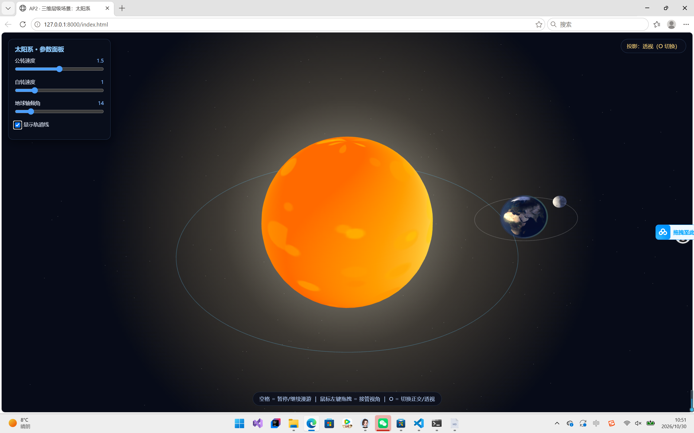
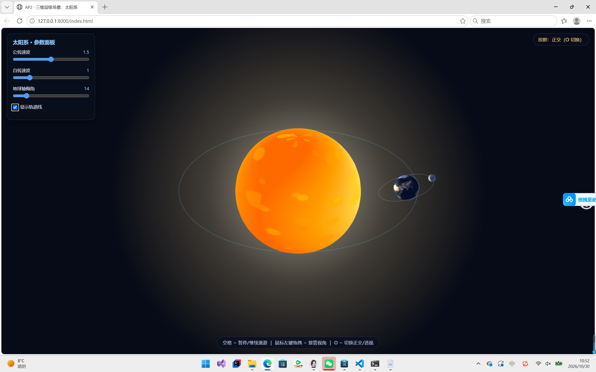

# AP2 · 三维层级场景：太阳系

> 教材：Angel & Shreiner, *Interactive Computer Graphics*, 8th ed. (Ch4–5)
> 技术栈：**Three.js + 原生 JavaScript**（教材明确允许），无构建步骤，静态服务器即可运行。

---

## 一、运行方式

本项目是纯前端静态页面，需要静态服务器打开 `index.html`。推荐两种方式：

### 方式 A（推荐）：VS Code + Live Server 插件
1. VS Code 扩展商店搜索 **Live Server**（作者 Ritwick Dey），安装。
2. 在 `index.html` 上右键 → **Open with Live Server**。
3. 浏览器自动打开 `http://127.0.0.1:5500/index.html`。

### 方式 B：Python 自带服务器
在项目文件夹下打开终端，执行：
```
python -m http.server 8000
```
然后浏览器访问 `http://127.0.0.1:8000/index.html`。

---

## 二、实现要点

### 1. 层级结构（变换嵌套树）

```
scene
└─ sunGroup（太阳自转）
   ├─ sunMesh（太阳，自发光 + 光晕）
   └─ earthOrbit（地球公转轨道组，绕太阳公转）
      └─ earthTilt（地球自转轴倾角容器，rotation.z = 23.5°）
         └─ earthSystem（偏移到公转轨道半径处）
            ├─ earthMesh（地球本体，自转）
            ├─ atmos（地球大气层，半透明蓝色薄球）
            └─ moonOrbit（月球轨道组，手动矩阵实现公转 + 轨道面倾角）
               └─ moonMesh（月球，自转）
```

**"先转后挂"的体现**：地球自转轴倾角加在**地球自身的容器 `earthTilt`** 上（先施加 23.5° 旋转），`earthTilt` 再整体作为 `earthOrbit` 的子节点随地球绕太阳公转。变换顺序决定结构——先转后挂，表达"地球自转轴倾斜 + 公转"的叠加关系。

### 2. 手动矩阵（对应教材 Ch4 变换推导）

月球轨道面倾角**没有用 Three.js 封装的复合函数**，而是用 `Matrix4` 的基本变换手工构造并 `multiplyMatrices` 组合：

```
M = RotY(月球公转角) · RotX(轨道面倾角) · T(月球轨道半径)
```

- `T(1.2, 0, 0)`：先平移到月球轨道半径处
- `RotX(5.1°)`：再 X 方向倾斜轨道面
- `RotY(moonAngle)`：最后绕 Y 轴公转

矩阵乘法顺序（从右到左应用）：先平移 → 再倾斜 → 再公转。代码在 `main.js` 的 `updateMoonOrbitMatrix()` 函数。

### 3. 表面纹理

- **太阳**：程序化 Canvas 生成（橙黄渐变 + 光斑），自发光
- **地球**：真实 NASA Blue Marble 贴图（`textures/earth.jpg`），带大气层效果
- **月球**：真实月球表面贴图（`textures/moon.jpg`），灰色陨石坑细节

用 CanvasTexture / TextureLoader 上传，底层即 `gl.texImage2D` + 纹理坐标采样。本地文件加载，离线可用，规避网络加载失败和上下颠倒问题。

### 4. 双投影对比（O 键切换）

维护透视相机（`PerspectiveCamera`）和正交相机（`OrthographicCamera`）。按 `O` 切换：
- **透视投影**：近大远小，平行线在远处汇聚（符合人眼）
- **正交投影**：物体大小与距离无关，平行线永远平行（工程制图风格）

两个相机每帧同步相同位姿，只是投影方式不同，方便对比。

### 5. 相机漫游 + 鼠标接管

- 默认自动漫游：相机沿圆形路径环绕场景一周，始终看向原点
- **空格**：暂停 / 继续所有运动
- **鼠标左键拖拽**：随时接管视角（OrbitControls 旋转），松开后回到自动漫游

---

## 三、交互说明

| 操作 | 效果 |
|---|---|
| **空格** | 暂停 / 继续所有运动（太阳、地球、月球、相机） |
| **O** | 切换 正交投影 / 透视投影 |
| **鼠标左键拖拽** | 接管视角（旋转观察） |
| **鼠标滚轮** | 拉近 / 拉远 |
| 参数面板·公转速度 | 调节地球绕太阳公转快慢 |
| 参数面板·自转速度 | 调节地球自转快慢 |
| 参数面板·地球轴倾角 | 实时调整 23.5° 倾角 |
| 参数面板·轨道线 | 开关地球 / 月球轨道线显示 |

---

## 四、运行截图

### 4.1 双投影对比

| 透视投影（近大远小） | 正交投影（平行线平行） |
|---|---|
|  |  |

- **透视投影**：远处的轨道线向内汇聚，符合人眼观察；太阳明显比地球大且近大远小
- **正交投影**：物体大小与距离无关，轨道线永远保持平行椭圆，无透视变形

### 4.2 漫游录屏

10 秒环绕漫游演示：`walkthrough.mp4`（项目根目录）

---

## 五、提交检查清单

1. ✅ 可运行 URL（公网部署：GitHub Pages / 课程平台 / 个人主页）
2. ✅ 源码打包 zip（整个项目文件夹）
3. ✅ README.md（含层级结构树、手动矩阵说明、交互说明、截图）
4. ⚠️ 若参考了教材或他人代码，请注明出处

---

## 六、版权与参考声明

- 本实现使用 Three.js（MIT License）
- 地球贴图来自 NASA Blue Marble，月球贴图来自 NASA 月球勘测轨道器
- 代码独立撰写，遵循课程"独立完成"要求
